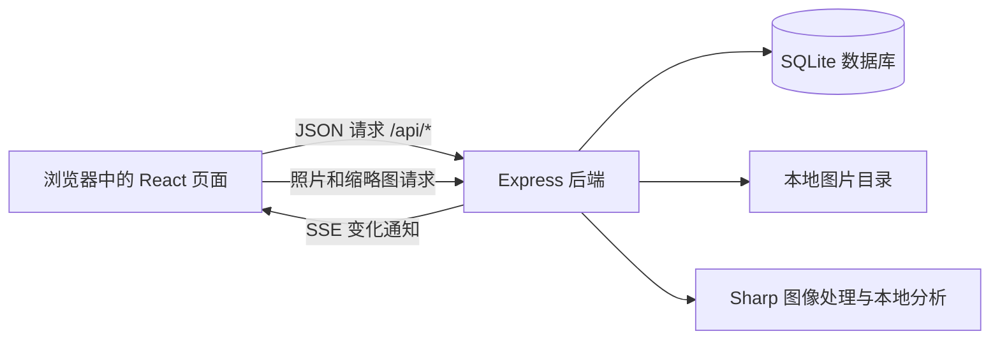
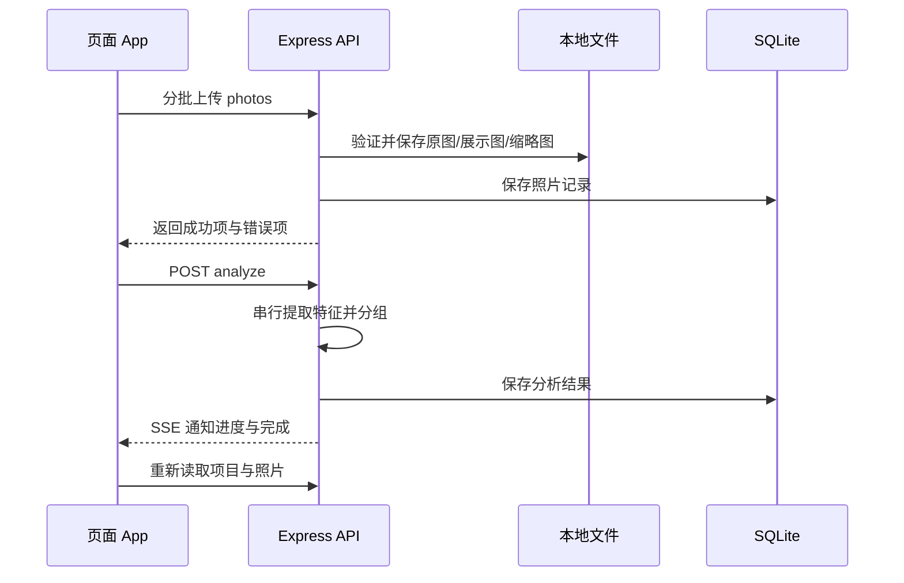

# 光影相册：项目结构与代码说明

> 项目位置：`D:\AI 智能相册`  
> 说明日期：2026-10-20  
> 本文按当前实际源码编写，帮助你分清前后端、理解每个项目文件，并找到以后修改功能的位置。

## 1. 先理解这个项目

光影相册面向摄影师和创作者，围绕“拍摄项目 → 上传照片 → 辅助选片 → 人工确认 → 发布作品”组织功能。

浏览器负责展示电影感相册、照片网格和沉浸预览；Node.js 服务负责账号、权限、照片保存和图像分析。数据库保存管理信息，照片文件保存在本地磁盘。

| 部分 | 使用的技术 | 主要职责 |
| --- | --- | --- |
| 前端 | React、TypeScript、Vite、CSS、Lucide 图标 | 页面、交互、请求、展示状态 |
| 后端 | Node.js、Express、Multer、Sharp | 接口、认证、上传、图片处理与分析 |
| 数据库 | Node.js 自带的 `node:sqlite` | 用户、会话、项目、照片信息与分析结果 |
| 图片存储 | 本地文件目录 | 原图、展示图、缩略图和上传临时文件 |
| 实时通知 | SSE / `EventSource` | 通知浏览器项目变化和分析进度 |

本地智能筛选使用文件哈希、图像差异哈希及清晰度指标。当前没有连接收费 AI 接口，也没有训练或部署用于理解语义的大模型。

### 1.1 前后端如何连接



前端不能通过数据库文件直接操作账号或照片，必须请求后端接口。前端隐藏某个按钮只是交互表现，真正的资源权限判断在后端执行。

## 2. 哪些文件属于前端，哪些属于后端

先记住以下分类即可：

| 分类 | 文件或目录 | 说明 |
| --- | --- | --- |
| 前端业务代码 | `src/` | 页面、组件、请求工具、交互和样式 |
| 前端页面入口 | `index.html` | 加载 React 的 HTML 容器 |
| 前端开发配置 | `vite.config.ts`、`tsconfig.json` | 开发服务器、代理、TypeScript 检查规则 |
| 前端公开资源 | `public/` | 图标及示例图片，可以直接公开访问 |
| 后端业务代码 | `server/app.mjs` | 数据库、权限、API、图像处理和分析 |
| 后端启动代码 | `server/index.mjs` | 启动 HTTP 服务，托管构建结果和公开页面 |
| 数据类型契约 | `shared/types.ts` | 用 TypeScript 描述接口数据结构，目前主要由前端引用 |
| 后端测试 | `tests/backend.test.mjs` | 在临时目录中验证真实接口流程 |
| 前后端共同配置 | `package.json`、`package-lock.json` | 依赖、脚本、版本及安装锁定信息 |
| Windows 运行辅助 | `启动相册.cmd` | 检查依赖、按条件构建、启动服务 |
| 文档 | `README.md`、本文 | 使用说明与代码导读 |
| 自动生成或运行数据 | `dist/`、`node_modules/`、`data/`、`tsconfig.tsbuildinfo` | 通常不直接编辑 |

`vite.config.ts` 虽然由 Node.js 执行，但它属于前端开发工具配置，不负责照片权限或数据库业务。

## 3. 项目目录总览

```text
D:\AI 智能相册\
├─ src/                            前端源码
│  ├─ main.tsx                     React 启动入口
│  ├─ App.tsx                      主界面及业务协调
│  ├─ api.ts                       JSON 请求与显示工具
│  ├─ styles.css                   全站样式和响应式布局
│  └─ components/
│     ├─ AuthView.tsx               登录与邀请注册
│     ├─ Modal.tsx                  通用弹窗
│     ├─ CoverDialog.tsx            封面和轮播配置
│     ├─ PhotoPreview.tsx           沉浸照片预览
│     └─ PhotoPreview.css           预览专用样式
├─ server/                         后端源码
│  ├─ app.mjs                      Express 应用和核心业务
│  └─ index.mjs                    服务启动及构建页面托管
├─ shared/
│  └─ types.ts                     接口数据类型
├─ tests/
│  └─ backend.test.mjs             后端集成测试
├─ public/                         可公开访问的静态资源
│  ├─ favicon.svg                  光圈图标
│  └─ demo/
│     ├─ kyoto-temple.png           寺院示例图
│     ├─ kyoto-rain.png             雨巷示例图
│     ├─ bamboo-walk.png            竹林示例图
│     └─ prompts.json              示例图生成来源与提示词
├─ data/                           运行后生成的持久化数据
│  ├─ album.sqlite                 SQLite 数据库
│  ├─ originals/                   原始图片
│  ├─ previews/                    WebP 展示图
│  ├─ thumbs/                      WebP 缩略图
│  └─ tmp/                         上传临时文件
├─ dist/                           Vite 构建结果
├─ node_modules/                   安装的第三方依赖
├─ .git/                           Git 版本记录
├─ .gitignore                      Git 忽略规则
├─ index.html                      前端 HTML 入口
├─ package.json                    项目脚本与依赖声明
├─ package-lock.json               依赖版本锁定
├─ tsconfig.json                   TypeScript 配置
├─ tsconfig.tsbuildinfo            编译检查产生的缓存
├─ vite.config.ts                  Vite 配置
├─ 启动相册.cmd                    Windows 启动脚本
├─ README.md                       现有使用说明
└─ 项目结构与代码说明.md            本文
```

运行中的 SQLite 可能另外产生 `album.sqlite-wal` 和 `album.sqlite-shm`。它们属于数据库的工作文件，不是重复的照片或无用缓存。

下面逐个说明项目自己维护的文件。`node_modules` 中的第三方文件、`dist` 中带哈希的产物以及用户上传的照片，按目录解释，不逐一列出动态文件名。

## 4. 前端代码逐文件介绍

### 4.1 `src/main.tsx`：前端从这里启动

该文件找到 `index.html` 中的 `#root` 元素，创建 React 根节点，渲染 `App`，并导入全站 `styles.css`。

它使用 `React.StrictMode`，帮助开发期间发现生命周期等问题。它不处理登录、不保存照片，也不直接访问数据库。

**阅读重点：** `ReactDOM.createRoot()`、`App`、全站 CSS 的导入位置。

### 4.2 `src/App.tsx`：整个工作台的业务协调中心

这是前端最重要、内容最多的文件。它把独立组件、后端数据和用户操作组合成完整应用。

文件内部除了 `App`，还定义了以下辅助部分：

| 名称 | 职责 |
| --- | --- |
| `useRoute()` | 读取路径，监听浏览器前进/后退，通过 `history.pushState()` 导航 |
| `PhotoCard` | 展示缩略图、文件名、分析提示、选中状态和保留按钮 |
| `CreateAlbum` | 新建项目表单，提交标题、地点和描述 |
| `Loading` | 统一的加载提示 |
| `Empty` | 没有项目、照片或搜索结果时的空状态 |
| `App` | 管理状态、请求、操作函数和页面组合 |

主要状态可以按组阅读：

| 状态组 | 典型变量 | 用途 |
| --- | --- | --- |
| 用户与页面 | `user`、`sessionLoading`、`path`、`tab` | 判断身份和当前界面 |
| 业务数据 | `albums`、`albumId`、`album`、`photos`、`publicAlbums` | 保存接口返回的数据 |
| 网格视图 | `filter`、`search`、`sort`、`selected`、`selecting` | 筛选、搜索、排序和多选 |
| 弹窗与预览 | `previewId`、`createOpen`、`coverOpen`、`publishOpen`、`deleteOpen` | 打开对应的操作界面 |
| 大屏播放 | `heroIndex`、`paused` | 当前封面照片和播放状态 |
| 异步反馈 | `loading`、`working`、`analyzing`、`analysisProgress`、`uploadState` | 加载、分析、上传进度 |
| 提示信息 | `toast`、`loadError`、`uploadErrors`、`dragging` | 成功提示、错误和拖入上传状态 |

主要操作函数：

| 函数 | 用途 |
| --- | --- |
| `patchPhoto()` | 提交评分、选片、回收或恢复等照片更新 |
| `patchAlbum()` | 保存封面、轮播或公开状态等相册设置 |
| `setCover()` | 将指定照片设为固定封面 |
| `analyze()` | 请求后端分析一个项目 |
| `upload()` | 检查文件、分批上传、汇总失败项并发起分析 |
| `importDemo()` | 主动导入示例项目 |
| `bulk()` | 对选中的照片逐张执行更新 |
| `publish()` | 发布或撤回公开作品集 |
| `copyLink()` | 复制公开作品的访问地址 |

`activeAlbumRef` 和 `routeRef` 保存最新项目与路径，防止较早请求的回包覆盖用户刚切换到的页面。列表读取使用 `AbortController`，切换依赖或卸载时取消旧请求。

前端没有使用 Redux、Zustand 或 React Router。当前状态由 React Hooks 管理；拍摄项目、智能选片和回收站主要通过 `tab` 切换。

**以后修改的位置：** 页面组合、导航、照片筛选、上传批次、封面播放、公开操作，应先查看此文件，再决定是否需要修改对应子组件或后端接口。

### 4.3 `src/api.ts`：普通 JSON 请求的统一出口

`api<T>()` 会给业务路径加上 `/api`，携带同源 Cookie；非 GET 请求增加 `X-Album-Client: 1`。普通请求体按 JSON 发送，失败时读取后端的 `error` 并抛出错误。

它还提供 `formatBytes()` 和 `formatDate()`，供界面把文件大小和日期转换成适合阅读的文本。

注意，以下请求不全部经过该函数：

- 上传使用 `XMLHttpRequest`，因为需要读取上传进度。
- 实时消息使用 `EventSource`。
- 图片展示与下载直接访问照片 URL。

**以后修改的位置：** 普通请求的通用请求头、错误处理或显示格式。不要把前端请求头当成完整的权限保证，权限仍由服务端检查。

### 4.4 `src/components/AuthView.tsx`：登录和受邀注册

负责认证页面的电影感背景、登录表单、注册表单和错误反馈。注册时收集称呼、邮箱、密码及邀请码；登录时使用邮箱和密码。

表单分别调用 `/api/auth/register` 或 `/api/auth/login`。成功后，通过 `onLogin(user)` 把用户交给 `App`，由主应用进入工作台。

本组件还提供公开作品入口，允许用户先不登录，浏览已发布作品。背景图片来自本地 `public/demo/kyoto-temple.png`。

**以后修改的位置：** 认证页面布局、表单文案和字段交互。真正的密码规则、邀请校验和登录判断要同步查看后端。

### 4.5 `src/components/Modal.tsx`：可复用的弹窗容器

新建项目、封面配置、发布和批量删除确认等操作复用这个组件。

它处理标题、关闭按钮、遮罩、普通/宽版布局，以及通用的键盘与焦点行为：Esc 关闭、Tab 在弹窗内循环、打开时锁定背景滚动、关闭后恢复原焦点。

`onCloseRef` 保存最新的关闭回调，避免父组件刷新时反复重建焦点管理。

**以后修改的位置：** 多数业务弹窗共有的外框和交互。具体弹窗中的字段与保存逻辑属于调用它的组件。

### 4.6 `src/components/CoverDialog.tsx`：封面与轮播设置

它编辑并提交四项设置：

| 字段 | 用途 |
| --- | --- |
| `coverMode` | 固定照片 `fixed`、随机轮播 `random` 或顺序轮播 `slideshow` |
| `coverPhotoId` | 固定封面照片 |
| `coverPhotoIds` | 随机或顺序展示的照片范围；空选择表示使用全部有效照片 |
| `slideInterval` | 每张展示多少秒 |

当前界面提供 5、8、12、20 秒选项。后端接受的范围为 3 至 30 秒的整数；两者分别是界面选项和接口约束。

保存通过 `onSave()` 回调交给 `App`。这个组件只编辑配置，实际轮播计时在 `App.tsx` 中执行。

**以后修改的位置：** 模式选择、照片选择和间隔选项；若增加新的配置字段，还要同步修改类型和服务端校验。

### 4.7 `src/components/PhotoPreview.tsx`：沉浸式大图预览

这个组件负责打开一张照片后的完整查看体验：

- 上一张、下一张和底部缩略图切换。
- 适合屏幕、实际像素、加减缩放、滚轮缩放、双击缩放。
- 放大后拖拽，并把平移限制在合理范围内。
- 展开文件信息，查看名称、尺寸、大小、格式和时间。
- 打星、保留/淘汰、设为封面、下载、移入回收站。
- 删除前二次确认，以及操作失败后的错误提示。

组件的重要输入与回调：

| 属性 | 用途 |
| --- | --- |
| `photos` | 参与当前预览的照片列表 |
| `initialId` | 第一次打开哪张照片 |
| `onClose` | 关闭预览 |
| `onUpdate` | 把评分、选片和软删除意图交给父组件保存 |
| `onSetCover` | 把当前照片设为封面 |
| `readOnly` | 公开只读模式，隐藏编辑动作 |

缩放由 `fitScale` 与 `zoom` 共同决定：前者是图片适应画布的比例，后者是在此基础上的放大倍数。`1:1` 对应浏览器实际加载图像的自然像素；公开访问时加载的是展示图，因此不是私密原图的像素比例。

`ResizeObserver` 追踪画布尺寸变化；图片加载状态绑定照片和重试键，避免快速切图时旧图片的加载事件覆盖当前状态。

主要快捷键：左右箭头切换，`+`/`-` 缩放，`0` 适合屏幕，Esc 关闭。删除确认期间会限制背景交互与焦点。

当前是单张大图与前后切换，并没有实现同步缩放的双图并排对比。拍摄时间缺失时显示“未记录”；当前未提取完整相机、镜头、GPS、光圈或快门等 EXIF 信息。

**以后修改的位置：** 大图查看、信息栏、快捷键、缩放和预览工具栏。服务器文件权限与真正的删除状态不在此组件中判断。

### 4.8 `src/styles.css`：全站视觉与响应式布局

该文件包含全站颜色、间距变量、基础元素，以及工作台、导航、项目条、顶部摄影大屏、照片网格、认证、通用弹窗、提示和上传状态的样式。

基础背景色为 `#10181b`，强调色为 `#39d4d0`，字体使用本地可用字体回退，不依赖远程字体服务。

照片网格的主要列数如下：

| 页面宽度 | 列数 |
| --- | --- |
| 1500px 及以上 | 5 列 |
| 1200–1499px | 4 列 |
| 720–1199px | 3 列 |
| 719px 及以下 | 2 列 |

较小屏幕还会进一步调整按钮、字体和间距。`prefers-reduced-motion` 用于尊重系统减少动态效果的偏好。

**维护重点：** CSS 后面的同名选择器可能专门覆盖前面的规则。不要直接合并或排序重复规则；改变先后顺序可能改变界面。

### 4.9 `src/components/PhotoPreview.css`：预览界面的独立样式

所有主要类名使用 `pp-` 前缀，与全站样式区分。它控制全屏背景、图片画布、工具栏、信息侧栏、胶片缩略图、删除确认和错误状态。

文件内还处理窄屏、低高度窗口、手机工具栏以及减少动态效果的适配。

**以后修改的位置：** 只想改变大图预览外观时，优先修改此文件；想改变全站主题则查看 `src/styles.css`。

## 5. 后端代码逐文件介绍

### 5.1 `server/app.mjs`：核心业务应用

导出的 `createApplication({ dataDir, demoDir, allowedOrigins })` 创建 Express 应用，并返回 `app` 与 `close()`。测试可以直接创建应用，而不必启动完整的正式页面服务。

目前数据库访问、接口和图像处理集中在这一个文件中，没有独立的 controller、service、repository 或 worker 目录。

建议按以下顺序阅读：

| 代码部分 | 关键名称 | 作用 |
| --- | --- | --- |
| 基础工具与限制 | `MAX_BYTES`、`MAX_PIXELS`、`textValue()`、`problem()` | 统一限制、参数和错误 |
| 初始化数据 | `DatabaseSync`、建表 SQL、`dirs` | 创建数据库和本地存储目录 |
| 请求中间件 | `app.use()` | 安全头、修改请求校验、JSON 解析、会话恢复 |
| 归属判断 | `requireUser`、`ownAlbum()`、`ownPhoto()` | 判断是否登录及资源是否属于本人 |
| 响应转换 | `photoJSON()`、`albumJSON()` | 将数据库字段转换为前端接口结构 |
| 会话与认证 | `setSession()`、`authRateLimit()`、认证路由 | 注册、登录、退出和限流 |
| 相册业务 | `createAlbum()`、相册路由 | 新建、读取与更新配置 |
| 上传与图片处理 | `upload`、`fileDigest()`、`insertImage()` | 接收文件、验证解码、保存原图与衍生图 |
| 分析特征 | `hamming()`、`computeFeatures()` | 比较差异哈希，计算颜色与清晰度 |
| 分析任务 | `queue`、`analyzeAlbum()`、`drainQueue()` | 串行分析、写入结果、通知前端 |
| 实时通知 | `clients`、`notify()`、`/api/events` | 维护当前用户的 SSE 连接 |
| 示例与错误处理 | `/api/demo`、统一错误中间件 | 导入示例并返回统一错误结构 |
| 退出处理 | `close()` | 结束通知连接，等待分析并关闭数据库 |

模块顶部的 `sharp.cache({ files: 0 })` 禁用 Sharp 的文件缓存，避免 Windows 下文件句柄长期占用，影响临时图片移动或清理。

#### 认证如何工作

密码使用随机盐和 `scrypt` 保存摘要；登录时用 `timingSafeEqual()` 比较，不保存明文密码。

浏览器的 `frame_session` Cookie 保存随机令牌，数据库保存令牌的 SHA-256。会话固定有效 30 天，Cookie 使用 `HttpOnly`、`SameSite=Lax`，`Secure` 根据请求协议判断。

修改类接口要求 `X-Album-Client: 1`，请求带 `Origin` 时还会检查来源。注册和登录按 IP 在当前进程内限流，15 分钟最多 30 次。

默认邀请码 `FRAME-FIRST-100` 只是一个共享邀请码，不代表已实现最多 100 人、单次邀请或邀请码过期管理。

#### 图片上传如何工作

```text
验证登录与相册归属
→ Multer 写入上传临时文件
→ Sharp 检查真实格式、尺寸和解码
→ 计算原始文件 SHA-256
→ 生成展示图和缩略图
→ 保存原图与数据库记录
→ 返回成功和失败项，通知页面刷新
```

限制为：静态 JPEG/PNG/WebP、单张最多 20MiB（界面写作 20MB）、每个请求最多 30 张、最多 8000 万像素，任一边最多 25000 像素。

前端会主动拆成每批 15 张，与后端 30 张上限并不冲突。格式必须通过后端实际解码，不能仅凭文件后缀判断。

混合有效与损坏图片时可以逐张返回部分成功；触发 multipart 文件数量、单文件大小等整体限制时，可能直接导致整个请求失败。

#### 分析算法的实际含义

| 能力 | 当前方法 | 结果 |
| --- | --- | --- |
| 完全重复 | 比较原始文件 SHA-256 | 记录 `duplicateOf` |
| 视觉相似 | 64 位 dHash、颜色均值约束、并查集合组 | 记录 `groupId` |
| 疑似模糊 | 归一化灰度图的拉普拉斯方差 | 记录 `sharpness` 和 `blur` |

数据库字段虽然叫 `phash`，实际使用的是 dHash：缩放到 `9 × 8`，比较每行相邻像素，得到 64 位特征，并非 DCT pHash。

非完全重复图片在颜色均值差的绝对值之和小于 70、且 dHash 汉明距离不超过 7 时，成为相似候选；相似关系通过并查集合组。清晰度小于 65 时标为疑似模糊。

这些阈值是当前规则，不是跨题材通用的摄影质量标准。浅景深、夜景、运动模糊、调色或裁切都可能影响结果。同组关系有传递性，不保证任意两张直接比较都满足阈值。

特征完整时会复用缓存，但重新分析仍会重新整理当前有效照片的关系。相似比较主要部分为 `O(n²)`，没有使用大规模图库的向量索引。

任务队列在一个 Node 进程的内存中串行执行。重启时会把未完成状态重置为 `idle`，不会自动恢复未完成任务；用户可以再次发起分析。人工评分和选片标记不被分析覆盖，分析不会自动删除照片。

### 5.2 `server/index.mjs`：真正启动服务的入口

运行 `npm.cmd start` 时，最终执行这个文件。

它根据自身文件路径推导项目根目录，因此项目从 C 盘移动到 D 盘后无需写死新目录。它读取环境配置，调用 `createApplication()`，监听端口，并在退出时关闭应用资源。

检测到 `dist/index.html` 时，还负责：

- 托管前端构建文件。
- 为 `/p/:slug` 输出公开作品内容、标题、简介、canonical 与 Open Graph 元信息。
- 为 `/explore` 输出公开作品入口与链接。
- 提供 `robots.txt`。
- 为其余前端路径返回入口 HTML。

这里是把公开内容注入构建后的 HTML，并不是使用 React SSR 框架。它有助于抓取公开内容，但不保证搜索引擎收录。未公开或已撤回的作品返回 404 和不收录标记。

**以后修改的位置：** 服务监听、部署来源、静态资源托管和公开页面的 HTML 元信息。通常不在这里新增数据库业务逻辑。

## 6. 后端 API 速查

所有路径已经包含 `/api` 前缀。

| 方法 | 路径 | 功能 |
| --- | --- | --- |
| GET | `/api/auth/session` | 获取当前用户；未登录返回 `{ user: null }` |
| POST | `/api/auth/register` | 邀请注册并建立会话 |
| POST | `/api/auth/login` | 邮箱密码登录 |
| POST | `/api/auth/logout` | 退出并撤销当前会话 |
| GET | `/api/albums` | 获取自己的项目 |
| POST | `/api/albums` | 创建项目 |
| GET | `/api/albums/:id` | 项目详情及未回收照片 |
| PATCH | `/api/albums/:id` | 更新项目文字、封面、轮播与公开状态 |
| POST | `/api/albums/:id/photos` | 上传，表单字段名 `photos` |
| POST | `/api/albums/:id/analyze` | 加入分析队列 |
| PATCH | `/api/photos/:id` | 评分、选片、软删除或恢复 |
| GET | `/api/photos/:id/file` | 所有者取得原图，公开访问者取得展示图 |
| GET | `/api/photos/:id/preview` | 受权限控制的 WebP 展示图 |
| GET | `/api/photos/:id/thumb` | 受权限控制的 WebP 缩略图 |
| GET | `/api/trash` | 自己回收站里的照片 |
| GET | `/api/public/albums` | 已公开项目列表 |
| GET | `/api/public/albums/:slug` | 公开项目详情 |
| GET | `/api/events` | 登录用户的 SSE 连接 |
| POST | `/api/demo` | 主动导入示例项目 |

常见响应：列表为 `{ albums }`，项目详情为 `{ album, photos }`，照片更新为 `{ photo }`，上传为 `{ photos, errors }`，错误为 `{ error }`。

当前没有永久删除照片、删除项目、删除账号、找回密码或邮箱验证的接口。

## 7. 共享类型：`shared/types.ts`

这个文件描述前端使用的数据契约：

| 类型 | 含义 |
| --- | --- |
| `CoverMode` | `fixed` / `random` / `slideshow` |
| `Pick` | `none` / `keep` / `reject` |
| `User` | 用户 ID、称呼、邮箱 |
| `Album` | 项目文字、封面设置、轮播间隔、公开状态、slug、照片数与统计 |
| `Photo` | 文件信息、归属、分析候选、选片结果、评分和图片访问地址 |
| `PhotoPatch` | 照片更新时允许提交的字段 |

几个容易混淆的字段：

- `rating` 是 0–5 星，`pick` 是是否保留/淘汰，两者独立。
- `groupId` 是相似组，`duplicateOf` 是完全重复时对应的原件。
- `deletedAt` 有值表示在回收站，不代表磁盘已永久删除。
- `createdAt` 是记录创建/导入时间；当前 `capturedAt` 固定为 `null`，尚未提取拍摄时间。
- `url`、`previewUrl`、`thumbnailUrl` 指向受权限控制的后端接口，不是直接的磁盘路径。

后端目前是 JavaScript，不会自动使用 TypeScript 接口校验请求。修改类型后仍须同步核对后端参数和 `photoJSON()` / `albumJSON()`。

## 8. 数据库与照片究竟存在哪里

默认位置：`D:\AI 智能相册\data`，可由 `DATA_DIR` 环境变量覆盖。

| 位置 | 用途 | 是否应该手工编辑 |
| --- | --- | --- |
| `album.sqlite` | 账号、会话、项目与照片信息 | 通常通过程序操作 |
| `originals/` | 原始图片，使用生成的 UUID 文件名 | 不要仅靠改名或移动来整理相册 |
| `previews/` | 最大边不超过 3200px 的 WebP 展示图 | 由程序生成 |
| `thumbs/` | 最大边不超过 800px 的 WebP 缩略图 | 由程序生成 |
| `tmp/` | 上传与示例导入临时文件 | 由上传流程管理 |

四张业务表：

| 表 | 内容 |
| --- | --- |
| `users` | 邮箱、称呼、密码盐和密码摘要 |
| `sessions` | 会话令牌摘要、用户归属和过期时间 |
| `albums` | 项目、封面、轮播、公开与分析状态 |
| `photos` | 文件信息、哈希、分析结果、人工选片及回收时间 |

当前图片内容没有以 BLOB 存进数据库，采用“数据库管理信息 + 文件目录保存图片”。数据库开启 WAL、外键和忙等待；尚未设置独立版本化的 schema 迁移系统。

## 9. 三个关键业务流程

### 9.1 上传与分析



上传本身不会直接执行完整分析，前端在成功上传后另行发起分析请求。当前上传不是分片上传，也不支持断点续传；失败后重新选择文件重试。

### 9.2 封面和轮播

后端保存配置，前端按配置建立有效照片池。固定模式优先使用指定照片；随机和顺序模式优先使用指定范围，没有有效指定时使用全部有效照片。

随机轮播避开连续两次选择当前索引。用户暂停、打开预览或封面弹窗、候选少于两张、启用减少动态效果时不自动切换；浏览器页面隐藏时，计时回调也不切图。

封面设置持久化到数据库，当前轮播位置与暂停状态只是临时界面状态。

### 9.3 私密、公开和回收站

项目默认私密。公开后，其他人可读取该项目所有未回收的照片；**不是只公开已标记保留的照片**。标记“淘汰”但没有移入回收站的照片仍然属于公开范围。

| 访问者 | `/file` | `/preview` 与 `/thumb` |
| --- | --- | --- |
| 所有者 | 原图 | 展示图与缩略图 |
| 其他人 | 项目公开且照片未回收时，返回展示图 | 同样需要公开且未回收 |

`download=1` 设置附件下载。公开访问者下载的是去除原始 EXIF 等元数据的展示图；公开 JSON 仍包含文件名、尺寸等业务字段，不能理解成所有信息都被隐藏。

移入回收站只设置 `deleted_at`，文件保留且可以恢复。撤回公开会停止新的匿名访问；恢复到仍然公开的相册后，该照片也会重新公开。

## 10. 配置、静态资源和辅助文件逐个说明

### 10.1 根目录文件

| 文件 | 详细用途 |
| --- | --- |
| `index.html` | 指定页面语言、视口、主题色、标题、简介、favicon 和 `#root`，通过 `/src/main.tsx` 加载 React。页面主体来自组件，不在此手写完整工作台。 |
| `vite.config.ts` | React 插件、5173 开发端口、`strictPort`、`/api` 到 3001 的代理，以及 4173 预览端口。改开发代理时注意后端来源校验。 |
| `tsconfig.json` | TypeScript 严格检查、JSX 和模块解析配置；覆盖 `src`、`shared` 与 Vite 配置。 |
| `package.json` | 声明 Node.js 至少 24、ESM 模块类型、前后端依赖，以及 `dev`、`build`、`start`、`test` 脚本。 |
| `package-lock.json` | 锁定实际安装依赖，减少不同机器上的版本差异。新增/升级依赖时由安装工具维护。 |
| `.gitignore` | 告诉 Git 忽略依赖、构建、运行数据、环境文件、编译缓存与日志；不会删除这些文件，也不是访问控制。 |
| `启动相册.cmd` | 用自身所在位置作为工作目录；检查 Node，缺少依赖时安装，缺少构建入口时构建，再执行 `npm.cmd start`。它打印地址，不自动打开浏览器。 |
| `README.md` | 原有的启动、使用、数据、算法及后续上线说明；本文补充结构与代码导读。 |
| `项目结构与代码说明.md` | 本文，便于从文件层面理解系统和定位修改位置。 |

### 10.2 `public/` 中的每个项目资源

| 文件 | 详细用途 |
| --- | --- |
| `public/favicon.svg` | 浏览器标签页使用的本地光圈图标。 |
| `public/demo/kyoto-temple.png` | 寺院示例照片，也用于认证页背景。 |
| `public/demo/kyoto-rain.png` | 雨巷示例照片。 |
| `public/demo/bamboo-walk.png` | 竹林示例照片。 |
| `public/demo/prompts.json` | 记录三张生成示例图的来源、目的和完整提示词；不是 AI 服务密钥或客户端模型配置。 |

示例图为生成素材，不是用户真实拍摄记录。用户主动导入示例时，后端还创建重复、相似与模糊变体，用于体验筛选流程。

`public/` 可直接公开访问，真实用户的私密照片应通过后端媒体接口访问，不应放在这里。

### 10.3 自动生成与版本管理目录

| 文件/目录 | 内容及维护方式 |
| --- | --- |
| `dist/index.html` | 构建后的页面入口，由后端正式模式托管。 |
| `dist/assets/*` | 构建的 JS/CSS，文件名中的哈希会随构建变化。应修改 `src/` 后重新构建，不直接改这些文件。 |
| `dist/demo/*`、`dist/favicon.svg` | 构建时复制的公开资源；原始来源是 `public/`。 |
| `node_modules/` | 第三方依赖，由包管理器维护，不是项目业务源码。 |
| `tsconfig.tsbuildinfo` | TypeScript 构建检查缓存，不写业务逻辑。 |
| `.git/` | Git 对象、索引、分支和提交等内部记录，不直接手改。 |

## 11. 测试文件：`tests/backend.test.mjs`

此文件通过 `createApplication()` 创建真实应用，使用独立临时数据目录和动态端口，用 Sharp 生成真正的 JPG、PNG、WebP 图片，再通过 HTTP 请求验证行为。

现有 7 个集成测试覆盖：

1. 邀请注册、登录、退出及跨服务重启的会话与文件持久化。
2. 多用户与匿名访问的资源隔离，修改请求校验。
3. 实际图片上传，以及混合无效文件的部分成功。
4. 封面模式保存和跨相册照片限制。
5. 公开展示的元数据处理、回收/恢复与撤回访问。
6. 后台重复分析、不自动删除、不覆盖人工决定。
7. 登录用户的 SSE 变化通知。

这些是关键后端流程测试，并不表示所有接口、浏览器交互、性能或生产部署都已被该文件完整覆盖。例如 `/preview` 路由和公开 HTML 没有在这 7 个测试里直接逐项覆盖。

## 12. 如何运行和继续开发

### 12.1 开发模式

```powershell
Set-Location -LiteralPath 'D:\AI 智能相册'
npm.cmd run dev
```

打开 `http://127.0.0.1:5173`。Vite 提供前端，Express 在 3001 提供 API；开发脚本给后端传入 `--dev`，仅额外允许明确的两个本地 Vite 来源。

### 12.2 构建后运行

```powershell
Set-Location -LiteralPath 'D:\AI 智能相册'
npm.cmd run build
npm.cmd start
```

打开 `http://127.0.0.1:3001`。此时 Node 同时提供构建页面和 API。

已有 `dist/index.html` 时，启动脚本不会根据源码更新时间自动重建。将来修改前端功能后，需要主动运行 `npm.cmd run build`，或用开发模式查看源码变化。

### 12.3 常用检查

```powershell
# 后端集成测试：在独立临时数据中运行
npm.cmd test

# 只检查 TypeScript，不生成页面或更新编译缓存
node node_modules/typescript/bin/tsc --noEmit --incremental false
```

### 12.4 环境配置

| 配置 | 默认值/用途 |
| --- | --- |
| `DATA_DIR` | 默认项目下的 `data/` |
| `PORT` | 后端端口，默认 3001 |
| `HOST` | 默认 `127.0.0.1` |
| `INVITE_CODE` | 默认 `FRAME-FIRST-100` |
| `PUBLIC_ORIGIN` | 正式来源校验及公开页面 canonical 等 |
| `TRUST_PROXY=1` | 在可信代理部署时信任一层代理，用于识别协议等 |
| `--dev` | 后端启动参数，额外允许明确的本地 Vite 来源 |

开发代理默认指向 3001；只改后端端口而不改代理，会导致开发页面无法调用 API。

## 13. 以后想改一个功能，先看哪里

| 想修改的内容 | 优先阅读 |
| --- | --- |
| 工作台布局、大图位置、导航 | `src/App.tsx` + `src/styles.css` |
| 整体颜色、字号、留白、手机布局 | `src/styles.css` |
| 登录/注册页面 | `AuthView.tsx` + 全站 CSS |
| 密码、邀请码或会话规则 | `server/app.mjs` 的认证部分 |
| 新建项目表单 | `App.tsx` 的 `CreateAlbum` |
| 封面设置界面 | `CoverDialog.tsx` |
| 大屏轮播的计时与切换 | `App.tsx` 的封面池与相关 Effect |
| 图片缩放、快捷键和详情栏 | `PhotoPreview.tsx` + `PhotoPreview.css` |
| 上传限制、图像格式与衍生图 | `App.tsx` 的 `upload()` + 后端 `insertImage()` / Multer 配置 |
| 重复、相似或模糊规则 | `server/app.mjs` 的 `computeFeatures()` / `analyzeAlbum()` |
| 公开范围和媒体访问权限 | `server/app.mjs` 的公开路由及媒体路由 |
| 公开作品的 HTML 标题和简介 | `server/index.mjs` |
| 修改 API 字段 | 后端响应转换 + `shared/types.ts` + 对应前端调用 |

目前一些功能还没有实现，例如自然语言搜图、人脸分类、RAW/HEIC、断点续传、永久删除、密码找回、账号容量配额和持久化任务队列。理解这些边界，能避免把界面中的“智能”误认为已经具备全部 AI 能力。

## 14. 本次代码整理做了什么

本次只整理以下 14 个代码文件的格式和说明性注释：

```text
src/main.tsx
src/api.ts
src/App.tsx
src/styles.css
src/components/AuthView.tsx
src/components/Modal.tsx
src/components/CoverDialog.tsx
src/components/PhotoPreview.tsx
src/components/PhotoPreview.css
shared/types.ts
server/app.mjs
server/index.mjs
tests/backend.test.mjs
vite.config.ts
```

统一采用 2 空格缩进、约 100 字符的排版宽度，展开长 JSX、长参数、复合语句和 CSS 声明，保留原有的函数、请求、状态顺序和规则覆盖顺序，并增加模块用途及关键流程的中文注释。需要保留的 JSX 可见空格也进行了保留。

格式化工具仅用于临时工作目录，没有加入本项目依赖；`package.json` 与 `package-lock.json` 保持原样。

核验方式：

- 对整理前后转译后的执行代码结构进行比对。
- 对 CSS 的选择器、声明与媒体规则及其顺序进行比对。
- 整理稿通过现有 7 项后端集成测试。
- 整理稿通过 TypeScript 无输出检查。
- 回写限定为上述代码文件及新增的本说明文件，并核对其他项目文件。

本次没有修改照片、数据库、静态素材、现有 README、依赖、锁文件、构建产物、启动脚本或 Git 记录，也没有删除旧位置的项目。没有为了格式整理重新构建真实项目的 `dist/`。

建议第一次阅读时按以下顺序：`src/main.tsx` → `src/App.tsx` → 对应组件 → `src/api.ts` → `shared/types.ts` → `server/index.mjs` → `server/app.mjs` → `tests/backend.test.mjs`。
